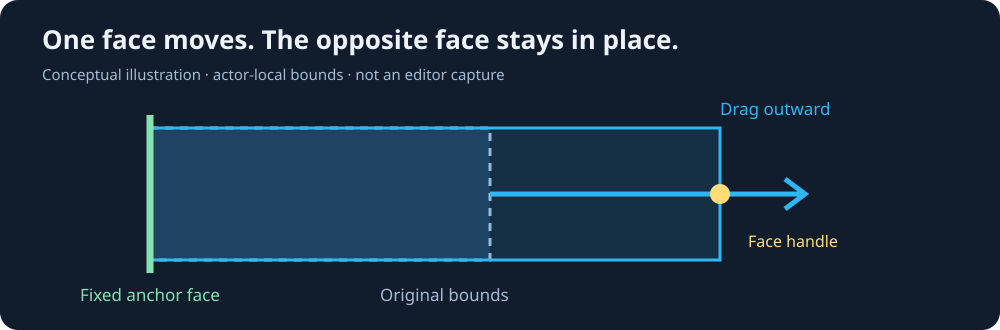

# OneSideScale

**One-sided scaling for Unreal Engine's Level Editor.**

Drag one face of a mesh while the opposite face stays fixed. Includes six face
handles, grid snapping, and undo/redo. Mesh geometry and stored pivot offsets
stay unchanged.



## Install

Requires Unreal Engine and its C++ build tools. Development target: **UE 5.8.2**.

1. Close Unreal Editor and run this from your Unreal project's directory:

   ```sh
   git clone https://github.com/NukeItGames/OneSideScale-Portfolio.git Plugins/OneSideScale
   ```

2. Regenerate project files and build your project's **Editor** target.
3. Open the project and check that **OneSideScale** is enabled under Edit → Plugins.

For a standalone test project or Blueprint-only installation, see [setup](docs/SETUP.md).

## Use

Select one unlocked, unattached **Static Mesh Actor** or **Dynamic Mesh Actor**.
Click **OneSideScale** beside Scale, then drag a colored face handle. Snapping
uses the viewport's translation grid.

| Control | Action |
| --- | --- |
| T | Activate OneSideScale in the focused Level Editor viewport |
| Space | Cycle Move → Rotate → Scale → OneSideScale |
| W / E / R | Return to native Move / Rotate / Scale |
| Escape during a drag | Cancel and restore the starting transform |

Multi-selection, attached actors, instances, and skeletal meshes are unsupported.
See [controls and limitations](docs/REFERENCE.md) for details.

## Status

Used successfully in Unreal Engine by its author. Portfolio CI passes on Windows
and Linux; Unreal compilation and automation tests were not run during publication.
See [validation results](docs/VALIDATION.md) and [editor testing](docs/EDITOR_TESTING.md).

## License

[MIT](LICENSE). Unreal Engine remains under Epic's separate terms.
[Third-party notices](THIRD_PARTY_NOTICES.md).
